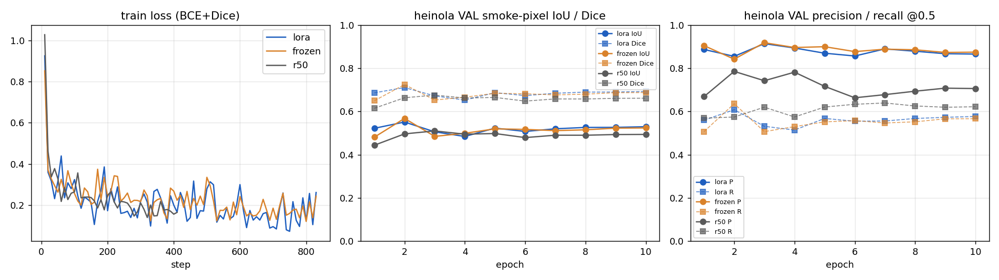

# V5b — Thin-smoke SEGMENTATION branch on DINOv3-L (real trained weights)

Run `segV5b_a` · 2026-10-02 07:44–08:06 UTC · 1 g6e node (8x L40S), ~19.5 node-minutes total · track `seg` · registry job `res-segv5b-a` (released).
Written by the seg agent of V5b phase 1. Nothing under reports/v4, reports/v5 or STATUS.md was edited.

## 0. Summary (what was built, what it does, what it does not do)

* **Delivered**: a 1-channel smoke-probability head (UPerNet-lite / FPN-lite, 2.30 M params) on the iteration-3/4 DINOv3-L/16 backbone + SimpleFeaturePyramid neck (`src/v5b/seg_head.py`), trained on **628 eligible Boreal masks + 37 author-verified negatives from the TRAIN burns only (evo + karkkila)**, validated on **heinola** (aerial VAL; 382 frames, never trained), in three variants: DINOv3-L **frozen**, DINOv3-L **LoRA r16**, and a **ResNet-50 (ImageNet, frozen) + identical decoder** baseline (the "simpler segmentation baseline" allowed instead of porting FoSp). FoSp (Frequency-Oriented Smoke Segmentation, Yao et al.) is cited as METHOD REFERENCE only — no FoSp / SmokeSeg / FIgLib data or weights were used.
* **Headline (heinola VAL, thr 0.5, best epoch chosen on VAL)**: frozen DINOv3-L smoke-pixel IoU **0.568** / Dice 0.724 / P 0.842 / R 0.636; LoRA r16 IoU **0.551** / Dice 0.710 / P 0.855 / R 0.608; ResNet-50 baseline IoU **0.510** / Dice 0.675 / P 0.742 / R 0.620. DINOv3 beats the baseline on **6/6** (frozen) and **5/6** (LoRA) heinola flights with positives (paired per-frame mean ΔIoU +0.070 / +0.058). Frozen vs LoRA is a wash (+0.012 mean ΔIoU, 4/6 flights) — with 665 training frames LoRA overfits after epoch 2.
* **Mask→box recall vs the authors' one-big-box labels (336 boxes)**: frozen 0.830 (component bbox IoU≥0.4) / 0.878 (union bbox IoU≥0.4) / **0.997** (localisation hit); LoRA 0.804 / 0.860 / 0.994; R50 0.854 / 0.878 / 1.000. The GT masks themselves only reach 0.887 / 0.946 / 1.000 under the same criteria (boxes include background), so the IoU-based criteria are capped well below 1.
* **False alarms on the 46 author-negative heinola frames**: every model fires on **21/21 frames of flight heinola_DJI_0024** (a clear-cut with bare ground, see failure case 8) and 0/25 on DJI_0028 (R50: 25/25). For the DINOv3 models the spurious blobs are small (frozen: max 0.75 % of the frame, 0/46 frames with a blob ≥1 %; LoRA 3/46), for R50 they are larger (median 205 FP px/frame at stride 4). A thin-smoke map therefore cannot be used as a stand-alone alarm; it is a localisation/explanation layer for the detector.
* **CPU inference**: `scripts/v5b/seg_infer.py` (`SmokeSegmenter.predict(PIL) -> HxW prob map` / `predict_png`) — 2.6–2.9 s per 2048x1080 frame with DINOv3-L at 1280x736 on this host (32 threads), 0.15 s for the R50 baseline. Demo-slot ready (`/segment`), tested with the real LoRA and frozen checkpoints.
* **Honest caveats**: (i) 329/336 VAL positive masks are SAM model-assisted, not human — IoU against them measures agreement with SAM, and 38/336 GT masks fail IoU≥0.4 against their own author box (label bleed; e.g. failure case 7 is a GT error, the prediction follows the plume). The 7 human masks give IoU 0.47 (frozen) / 0.44 (LoRA) / 0.45 (R50) — thin, diffuse smoke is systematically under-segmented (qualitative 5). (ii) best.pt is the best of 10 epoch evaluations on VAL, so the headline is selection-optimistic; unselected final-epoch IoU is 0.523 (frozen) / 0.529 (LoRA) / 0.494 (R50). (iii) Only 3 configs, 1 seed, 1 held-out burn — no significance claims beyond the per-flight tallies above. (iv) The brief's "~1.4k masked frames" counts all four burns; only 628 masks belong to the TRAIN burns (heinola 336 are VAL, ruokolahti 453 are banned), and that is what was trained on.

## 1. Data provenance (every row recorded in `data/v5b/manifests/seg_v5b_manifest.json`; rows CSV `seg_v5b_rows_all.csv`)

Source: Boreal Forest Fire dataset (FGI, CC BY 4.0; card `data/v4/manifests/boreal_CARD.md`, manifest `boreal_manifest.parquet`, per-file sha256 carried into the v5b manifest as `src_sha256`). Data-use rules applied (PROTOCOL_V5 §2): evo + karkkila = TRAIN, heinola = aerial VAL (never training), ruokolahti = historical final test (never shipped to the pod), FIgLib and FIgLib-derived material = excluded, no SmokeSeg / FoSp data or weights. Subset-A boxes were NOT used as weak supervision (the optional box-to-mask auxiliary loss was not implemented — stated, not hidden); boxes are used only for the mask→box recall metric on VAL.

| role | burn | provenance | n frames | label origin | source files |
|---|---|---|---|---|---|
| TRAIN | evo | manual_human | 15 | HUMAN (authors' hand-drawn `manual_masks/test`) | Subset-C images/test evo* (15) |
| TRAIN | evo | sam_model_assisted | 294 | MODEL-ASSISTED (SAM prompted with the authors' human box; authors' Subset-C `sam_masks/`) | Subset-C images/{train,valid} evo* (273+21) |
| TRAIN | karkkila | author_negative_empty | 37 | HUMAN author label 'no smoke' (empty label file / Subset-A Empty-Images) -> CONVERTED to an all-zero mask (named conversion) | Subset-A Empty-Images karkkila* (37; 3840x2160 -> 1920x1080 at staging) |
| TRAIN | karkkila | manual_human | 12 | HUMAN (authors' hand-drawn `manual_masks/test`) | Subset-C images/test karkkila* (12) |
| TRAIN | karkkila | sam_model_assisted | 307 | MODEL-ASSISTED (SAM prompted with the authors' human box; authors' Subset-C `sam_masks/`) | Subset-C images/{train,valid} karkkila* (269+38) |
| VAL | heinola | author_negative_empty | 46 | HUMAN author label 'no smoke' (empty label file / Subset-A Empty-Images) -> CONVERTED to an all-zero mask (named conversion) | Subset-C images/{train,valid} heinola* with empty label (25+21) |
| VAL | heinola | manual_human | 7 | HUMAN (authors' hand-drawn `manual_masks/test`) | Subset-C images/test heinola* (7) |
| VAL | heinola | sam_model_assisted | 329 | MODEL-ASSISTED (SAM prompted with the authors' human box; authors' Subset-C `sam_masks/`) | Subset-C images/{train,valid} heinola* (266+63) |

* TRAIN = **665 frames** (601 SAM model-assisted + 27 human masks + 37 author-negatives), 13 DJI flights (evo 3, karkkila 10); native 2048x1080 (309) / 1920x1080 (356). VAL = **382 heinola frames** (329 SAM + 7 human + 46 author-negatives), 7 flights, all 2048x1080.
* **Excluded**: 5 evo Subset-C frames with no label and no mask (`evoDJI_0001_frame216–220`; smoke visible per the card — never used as negatives); all heinola Subset-A frames beyond Subset-C (not needed); all ruokolahti rows (453 masks) — never staged.
* Named conversion: author "no smoke" frames → all-zero mask (listed as `author_negative_empty`). Nothing else was converted between label types. Automated inspection in this report is not human review.
* Staging tar `/local/home/tianrgua/cvproject/data/v5b/stage/seg_v5b.tar` sha256 `7021cca3111fa5a626de76681c01c6db3b59fe0cd4d71bda8a667bdd771917b1` (468 MB), uploaded once to `s3://smoke-detect-data-000000000001-use1/v5b/data/seg_v5b.tar`, extracted on FSx `/scratch/scratch/tianrgua-sandbox/smoke/v5bdata/seg_v5b/` (marker `.seg_v5b.done`). Subset-C was NOT in any v4 FSx tar (checked `CORPUS_*_v1.json`: 0 Subset-C paths). ResNet-50 IMAGENET1K_V2 weights (`resnet50-11ad3fa6.pth`, sha256 `11ad3fa62ca79e40…`) shipped inside the tar (pods are offline).

## 2. Model and training

| | DINOv3-L frozen | DINOv3-L LoRA r16 (α32) | ResNet-50 baseline |
|---|---|---|---|
| backbone | `facebook/dinov3-vitl16-pretrain-lvd1689m` rev ea8dc286 (FSx snapshot), patch 16, 4 registers; frozen (eval mode) | same; base frozen, LoRA A/B on q/k/v/o of all 24 blocks (`src/v3/det_modeling.inject_lora`), grad checkpointing | torchvision resnet50 IMAGENET1K_V2, C2–C5 (strides 4/8/16/32; 256/512/1024/2048 ch), frozen incl. BN stats |
| neck | SimpleFeaturePyramid (src/v3), 1024→256 ch, strides 4/8/16/32 (7,805,184 params, trainable) | same | none (lateral 1x1 convs in the head) |
| head | FPNLiteSegHead: PPM(1,2,3,6) on stride 32, lateral 1x1 + top-down + 3x3 smooth at strides 16/8/4, concat of 4 levels at stride 4 → 2x conv-GN-GELU → Dropout2d(0.1) → 1x1 logit; bias init −2; bilinear ×4 to input | same (2,297,217 params) | same decoder, in-channels (256,512,1024,2048) → 5,410,177 params |
| trainable / total params | 10,102,401 / 313,232,001 | **13,248,129** / 316,377,729 (LoRA 3,145,728 = 1.04 % of backbone) | 5,410,177 / 28,918,209 |
| input | letterbox 1280x736 (gray pad excluded from loss via `valid`), ImageNet mean/std (same as det stack) | same | same |
| loss | BCE + soft Dice (per-frame, smoothing 1) over valid pixels of frames WITH a mask (all 665 train frames by construction; `has_mask=False` rows would be masked out) | same | same |
| aug | h-flip 0.5, brightness/contrast/colour 0.8–1.2, scale jitter 0.75–1.0 with random placement on the canvas | same | same |
| optimiser | AdamW, head/neck lr 2e-4, wd 1e-4, warmup 50 steps, cosine to 0, grad-clip 5, bf16 autocast | + backbone (LoRA) group lr 1e-4 | head lr 2e-4 |
| batch / GPUs | 4 per GPU × 2 GPUs (L40S 4,5) = 8 | 2 per GPU × 4 GPUs (L40S 0–3) = 8 | 8 per GPU × 2 GPUs (L40S 6,7) = 16 |
| epochs / steps | 10 / 830 (83 steps/epoch) | 10 / 830 | 10 / 410 |
| speed | ~0.33 s/it | ~0.33 s/it (ckpt) | ~0.14 s/it |
| selection | best heinola VAL smoke-pixel IoU @0.5 among 10 epoch evals → **epoch 2, step 166** | **epoch 2, step 166** | **epoch 3, step 123** |
| checkpoint | `models/v5b/seg/segV5b_a/seg02/frozen/best.pt` (40.4 MB; neck+head only) sha256 `a60b4a7e736960b6…` | `models/v5b/seg/segV5b_a/seg01/lora/best.pt` (53.1 MB; neck+head+LoRA A/B) sha256 `4827375316266f46…` | `models/v5b/seg/segV5b_a/seg01/r50/best.pt` (21.7 MB; head only) sha256 `f7e0a51839d6ddd3…` |

All three configs ran CONCURRENTLY on one node (`cluster/v5b/seg_entry.sh`, `CONFIGS="lora:0,1,2,3:2;frozen:4,5:4;r50:6,7:8"`), each a separate `torchrun --standalone` process group. Checkpoints store only non-frozen tensors (+ args, param counts, VAL metrics at selection); `scripts/v5b/seg_infer.py` rebuilds the model from the local DINOv3-L snapshot (`models/v3/hf/dinov3-vitl16`, or `SMOKE_DINO_BACKBONE_DIR`) — weights are never downloaded. Full run manifest with sha256s: `models/v5b/seg/segV5b_a/MANIFEST.json`.

### Training curves



`seg_examples/curves_segV5b_a.png` — left: train loss (BCE+Dice) per 10 steps; middle: heinola VAL IoU/Dice per epoch; right: precision/recall @0.5 per epoch. Both DINOv3 variants peak at epoch 2 and then plateau ~0.52 IoU (LoRA's train loss keeps dropping to ~0.1 while VAL IoU does not improve → mild overfit to the two training burns). The R50 baseline plateaus at ~0.49–0.51.

## 3. Metrics (heinola VAL; metrics computed on the stride-4 prediction grid over valid letterbox pixels; "smoke IoU (all)" pools TP/FP/FN over all 382 frames incl. negatives)

### Headline (heinola VAL, 382 frames: 329 SAM-mask positives + 7 manual-mask positives + 46 author negatives; thr 0.5; metrics on valid letterboxed pixels at stride 4)

| config | best ep/step | smoke IoU (all) | Dice | precision | recall | mIoU pos frames | IoU vs SAM masks (329) | IoU vs manual masks (7) | mIoU manual (7) | neg FP pixel frac | neg frame FA (any comp) | neg frame FA (comp>=1%) |
|---|---|---|---|---|---|---|---|---|---|---|---|---|
| DINOv3-L + LoRA r16 + SFP + FPN-lite head | 166 | 0.551 | 0.710 | 0.855 | 0.608 | 0.591 | 0.556 | 0.442 | 0.445 | 0.0047 | 0.457 | 0.065 |
| DINOv3-L frozen + SFP + FPN-lite head | 166 | 0.568 | 0.724 | 0.842 | 0.636 | 0.604 | 0.571 | 0.474 | 0.476 | 0.0027 | 0.457 | 0.000 |
| ResNet-50 (ImageNet, frozen) + FPN-lite/U-Net-style head (baseline) | 123 | 0.510 | 0.675 | 0.742 | 0.620 | 0.534 | 0.514 | 0.453 | 0.450 | 0.0064 | 1.000 | 0.109 |

### Mask -> box recall vs the authors' boxes (336 boxed heinola frames; A: any component bbox IoU>=0.4; B: union bbox IoU>=0.4; C: >=30% of predicted pixels inside the GT box and >=10% of the box covered)

| config | A comp IoU>=0.4 | B union IoU>=0.4 | C hit | n boxes | GT-mask reference A / B / C |
|---|---|---|---|---|---|
| DINOv3-L + LoRA r16 + SFP + FPN-lite head | 0.804 | 0.860 | 0.994 | 336 | 0.887 / 0.946 / 1.000 |
| DINOv3-L frozen + SFP + FPN-lite head | 0.830 | 0.878 | 0.997 | 336 | 0.887 / 0.946 / 1.000 |
| ResNet-50 (ImageNet, frozen) + FPN-lite/U-Net-style head (baseline) | 0.854 | 0.878 | 1.000 | 336 | 0.887 / 0.946 / 1.000 |

### Parameters / training

| config | backbone trainable / total | neck | head | all trainable | steps | s/it (last) | epochs evaluated |
|---|---|---|---|---|---|---|---|
| DINOv3-L + LoRA r16 + SFP + FPN-lite head | 3,145,728 / 306,275,328 | 7,805,184 | 2,297,217 | 13,248,129 | 830 | 0.33 | 10 |
| DINOv3-L frozen + SFP + FPN-lite head | 0 / 303,129,600 | 7,805,184 | 2,297,217 | 10,102,401 | 830 | 0.28 | 10 |
| ResNet-50 (ImageNet, frozen) + FPN-lite/U-Net-style head (baseline) | 0 / 23,508,032 | - | 5,410,177 | 5,410,177 | 410 | 0.14 | 10 |

### Per-epoch heinola VAL IoU

| config | ep1 | ep2 | ep3 | ep4 | ep5 | ep6 | ep7 | ep8 | ep9 | ep10 |
|---|---|---|---|---|---|---|---|---|---|---|
| lora | 0.522 | 0.551 | 0.506 | 0.484 | 0.523 | 0.507 | 0.520 | 0.526 | 0.526 | 0.529 |
| frozen | 0.481 | 0.568 | 0.484 | 0.499 | 0.519 | 0.517 | 0.511 | 0.515 | 0.523 | 0.523 |
| r50 | 0.444 | 0.496 | 0.510 | 0.495 | 0.498 | 0.479 | 0.490 | 0.490 | 0.493 | 0.494 |

### Per-flight IoU on heinola (main configs; positives only, mean per-image IoU)

| flight | n pos | n neg | lora mIoU | frozen mIoU | r50 mIoU | lora neg FA | frozen neg FA | r50 neg FA |
|---|---|---|---|---|---|---|---|---|
| heinola_DJI_0024 | 0 | 21 | - | - | - | 1.00 | 1.00 | 1.00 |
| heinola_DJI_0025 | 79 | 0 | 0.522 | 0.562 | 0.513 | - | - | - |
| heinola_DJI_0028 | 5 | 25 | 0.551 | 0.571 | 0.556 | 0.00 | 0.00 | 1.00 |
| heinola_DJI_0029 | 42 | 0 | 0.836 | 0.836 | 0.698 | - | - | - |
| heinola_DJI_0030 | 81 | 0 | 0.601 | 0.624 | 0.557 | - | - | - |
| heinola_DJI_0033 | 90 | 0 | 0.555 | 0.564 | 0.535 | - | - | - |
| heinola_DJI_0036 | 39 | 0 | 0.538 | 0.489 | 0.345 | - | - | - |


Paired comparisons on the 336 positive frames (ΔIoU per frame; "win" = Δ>0.01): **frozen − LoRA** mean +0.012, median +0.004, win/tie/loss 46/23/30 %, per-flight Δ [+0.040, +0.021, 0.000, +0.023, +0.009, −0.049] → 4/6 flights; **frozen − R50** mean +0.070, median +0.055, win/tie/loss 72/10/18 %, 6/6 flights; **LoRA − R50** mean +0.058, median +0.028, win/tie/loss 62/12/26 %, 5/6 flights. Per-frame IoU quantiles (10/25/50/75/90 %): frozen 0.25/0.43/0.65/0.78/0.89; LoRA 0.22/0.39/0.64/0.78/0.90; R50 0.23/0.38/0.56/0.71/0.81. Frames with IoU<0.2: frozen 25 (7.4 %; flights 0030: 10, 0036: 8, 0033: 5), LoRA 29, R50 26.

### Threshold sweeps (from the dumped probability maps; `models/v5b/seg/segV5b_a/seg01/<cfg>/thr_sweep.json`)

DINOv3-L frozen
| thr | IoU | Dice | precision | recall | mIoU pos | neg frame FA (any comp) | neg frame FA (comp>=1%) | neg FP pixel frac |
|---|---|---|---|---|---|---|---|---|
| 0.2 | 0.573 | 0.729 | 0.800 | 0.669 | 0.600 | 0.478 | 0.152 | 0.0061 |
| 0.3 | 0.572 | 0.728 | 0.819 | 0.655 | 0.603 | 0.457 | 0.000 | 0.0046 |
| 0.4 | 0.570 | 0.726 | 0.832 | 0.644 | 0.604 | 0.457 | 0.000 | 0.0035 |
| 0.5 | 0.567 | 0.724 | 0.842 | 0.635 | 0.603 | 0.457 | 0.000 | 0.0027 |
| 0.6 | 0.563 | 0.721 | 0.852 | 0.625 | 0.602 | 0.457 | 0.000 | 0.0021 |
| 0.7 | 0.558 | 0.716 | 0.862 | 0.613 | 0.600 | 0.457 | 0.000 | 0.0016 |
| 0.8 | 0.549 | 0.709 | 0.873 | 0.597 | 0.596 | 0.457 | 0.000 | 0.0012 |
| 0.9 | 0.530 | 0.693 | 0.889 | 0.567 | 0.585 | 0.348 | 0.000 | 0.0007 |

DINOv3-L LoRA r16
| thr | IoU | Dice | precision | recall | mIoU pos | neg frame FA (any comp) | neg frame FA (comp>=1%) | neg FP pixel frac |
|---|---|---|---|---|---|---|---|---|
| 0.2 | 0.554 | 0.713 | 0.815 | 0.634 | 0.588 | 0.609 | 0.457 | 0.0078 |
| 0.3 | 0.553 | 0.712 | 0.831 | 0.623 | 0.590 | 0.500 | 0.391 | 0.0064 |
| 0.4 | 0.552 | 0.711 | 0.844 | 0.615 | 0.591 | 0.478 | 0.217 | 0.0055 |
| 0.5 | 0.550 | 0.709 | 0.854 | 0.606 | 0.590 | 0.457 | 0.065 | 0.0047 |
| 0.6 | 0.547 | 0.707 | 0.865 | 0.598 | 0.589 | 0.457 | 0.000 | 0.0038 |
| 0.7 | 0.541 | 0.702 | 0.876 | 0.586 | 0.586 | 0.457 | 0.000 | 0.0030 |
| 0.8 | 0.533 | 0.695 | 0.887 | 0.572 | 0.580 | 0.457 | 0.000 | 0.0021 |
| 0.9 | 0.512 | 0.677 | 0.905 | 0.541 | 0.565 | 0.370 | 0.000 | 0.0008 |

ResNet-50 baseline
| thr | IoU | Dice | precision | recall | mIoU pos | neg frame FA (any comp) | neg frame FA (comp>=1%) | neg FP pixel frac |
|---|---|---|---|---|---|---|---|---|
| 0.2 | 0.505 | 0.671 | 0.675 | 0.667 | 0.520 | 1.000 | 0.196 | 0.0117 |
| 0.3 | 0.508 | 0.674 | 0.703 | 0.647 | 0.526 | 1.000 | 0.174 | 0.0090 |
| 0.4 | 0.509 | 0.674 | 0.723 | 0.632 | 0.530 | 1.000 | 0.130 | 0.0075 |
| 0.5 | 0.508 | 0.674 | 0.742 | 0.618 | 0.532 | 1.000 | 0.109 | 0.0064 |
| 0.6 | 0.507 | 0.673 | 0.760 | 0.604 | 0.533 | 1.000 | 0.109 | 0.0055 |
| 0.7 | 0.504 | 0.670 | 0.780 | 0.588 | 0.533 | 0.913 | 0.087 | 0.0046 |
| 0.8 | 0.498 | 0.665 | 0.801 | 0.568 | 0.531 | 0.870 | 0.043 | 0.0038 |
| 0.9 | 0.482 | 0.651 | 0.835 | 0.533 | 0.523 | 0.739 | 0.022 | 0.0027 |

Reading: IoU is flat from thr 0.2 to 0.6 for the DINOv3 models (confident, well-separated maps); the negative-frame false-alarm rate is driven by one flight (DJI_0024 clear-cut) and does not go away with threshold — only its blob size does (frozen: 0 frames with a ≥1 % blob at thr ≥0.3). The R50 baseline leaks on every negative frame at every threshold ≤0.6.

## 4. Qualitative smoke maps (`reports/v5b/seg_examples/`, LoRA r16 model; panels = image | GT mask | predicted probability | overlay with cyan = prediction @0.5, green = GT contour)

| # | file | tag | frame | GT provenance | IoU | FP px | FN px |
|---|---|---|---|---|---|---|---|
| 1 | seg_examples/segV5b_a_lora_01_good_heinola_DJI_0029_frame179.png | good | heinola_DJI_0029_frame179 | sam_model_assisted | 0.95 | 216 | 293 |
| 2 | seg_examples/segV5b_a_lora_02_good_heinola_DJI_0030_frame250.png | good | heinola_DJI_0030_frame250 | sam_model_assisted | 0.94 | 32 | 161 |
| 3 | seg_examples/segV5b_a_lora_03_median_heinola_DJI_0033_frame43.png | median | heinola_DJI_0033_frame43 | sam_model_assisted | 0.64 | 244 | 3304 |
| 4 | seg_examples/segV5b_a_lora_04_median_heinola_DJI_0030_frame241.png | median | heinola_DJI_0030_frame241 | sam_model_assisted | 0.62 | 811 | 2382 |
| 5 | seg_examples/segV5b_a_lora_05_manual_gt_heinola_DJI_0028_frame182.png | manual_gt | heinola_DJI_0028_frame182 | manual_human | 0.43 | 36 | 5663 |
| 6 | seg_examples/segV5b_a_lora_06_negative_ok_heinola_DJI_0028_frame95.png | negative_ok | heinola_DJI_0028_frame95 | author_negative_empty | 1.00 | 0 | 0 |
| 7 | seg_examples/segV5b_a_lora_07_FAIL_missed_heinola_DJI_0036_frame235.png | FAIL_missed | heinola_DJI_0036_frame235 | sam_model_assisted | 0.06 | 2052 | 12518 |
| 8 | seg_examples/segV5b_a_lora_08_FAIL_false_alarm_heinola_DJI_0024_frame56.png | FAIL_false_alarm | heinola_DJI_0024_frame56 | author_negative_empty | 0.00 | 700 | 0 |

Notes per panel: 1–2 clean dense plumes (IoU 0.95/0.93); 3–4 median frames — the plume core is right, the thin trailing veil over the lake/horizon is partly missed (the typical error); 5 the only human-mask example in the set: the annotator marked the whole diffuse haze layer to the horizon, the model marks the dense third of it (IoU 0.43, FP only 36 px) — **thin diffuse smoke is under-segmented**, which is exactly where this branch was meant to help, so this is the honest headline weakness; 6 a correct empty map on a negative frame; **7 (failure: "missed")** — the SAM GT mask is a rectangle of sky (SAM bleed; the frame's GT bbox also fails the author-box check) while the prediction follows the visible plume: a *label* failure that the metric counts against the model; **8 (failure: false alarm)** — two blobs (700 px at stride 4, 1.0 % of the frame) on the bare-ground clear-cut of flight DJI_0024; every model, every threshold, every one of that flight's 21 negatives. Also shipped: `infer_demo_*` = CPU `seg_infer.py` outputs (prob PNG + overlay) for a heinola VAL frame (LoRA and frozen) and a karkkila TRAIN frame (LoRA).

## 5. Deliverables (paths)

| item | path |
|---|---|
| head / model / losses | `src/v5b/seg_head.py` (FPNLiteSegHead, DinoSeg, ResNet50Seg, seg_loss, saved_state_dict / load_saved_state_dict) |
| dataset | `src/v5b/seg_data.py` (letterbox, masks, valid/has_mask, `preprocess_image`) |
| trainer | `src/v5b/train_seg.py` (torchrun/DDP, bf16, per-epoch heinola eval incl. mask→box recall, best/last, prob-map dump, time budget/resume, DONE marker) |
| manifest + staging | `scripts/v5b/build_seg_manifest.py` → `data/v5b/manifests/seg_v5b_manifest.json`, `seg_v5b_provenance_table.csv`, `seg_v5b_rows_all.csv`, `seg_v5b_stage_info.json`, `data/v5b/stage/seg_v5b.tar` |
| cluster | `cluster/v5b/seg_entry.sh`, `cluster/v5b/orchestrate_seg.py` (reuses `cluster/v3/orchestrate_dino.py` ada/S3/kraken helpers), `scripts/v5b/seg_job_status.py` (S3 peek: pods have no logs) |
| weights | `models/v5b/seg/segV5b_a/seg02/frozen/best.pt` (recommended: best IoU, smallest), `seg01/lora/best.pt`, `seg01/r50/best.pt`; `models/v5b/seg/segV5b_a/MANIFEST.json`; per-config `metrics.jsonl`, `val_metrics_best.json`, `val_per_image.json`, `val_probs.tar`, `param_counts.json`, `console_tail.txt`, `thr_sweep.json` |
| CPU inference | `scripts/v5b/seg_infer.py` — `SmokeSegmenter(weights, device="cpu").predict(img) -> np.float32 HxW` / `.predict_png(img, out, overlay)`; CLI `--weights --image --out [--overlay]` |
| report tables / figs | `reports/v5b/seg_tables_segV5b_a.md`, `scripts/v5b/seg_report_tables.py`, `scripts/v5b/seg_report_figs.py`, `scripts/v5b/seg_thr_sweep.py`, `reports/v5b/seg_examples/*.png` |

## 6. Compute accounting and incidents

* Reservation `res-segv5b-a` (1 L40S node, track seg) 07:44–08:07 UTC, released. Kraken jobs: `tianrgua-sgsegv5bas1-69kq` 12 min (FAILED, exit 109), `…s2-39gt` 7 min (SUCCEEDED), `…s3-9imu` 30 s (no-op). ≈19.5 node-minutes ≈ 0.33 L40S node-hours; local CPU work only otherwise.
* Incident 1 (fixed): the pod presets `PET_RDZV_ENDPOINT`/`MASTER_PORT`, so three concurrent `torchrun --master_port` launches shared one rendezvous — LoRA trained, frozen hung, kraken's `maxRestarts: 1` restarted the pod once (R50 then won the rendezvous and trained). Fix: `env -u PET_* … torchrun --standalone` per config (segment 2 trained frozen cleanly). Resume logic skipped finished configs via the `DONE` marker on FSx, so nothing was retrained.
* Incident 2 (fixed): the entry's status JSON had a missing comma; the orchestrator did not salvage the phase and launched a 30 s no-op segment 3. Both fixed in `seg_entry.sh` / `orchestrate_seg.py`.
* Smoke-test scratch (CPU, tiny random ViT spec + real backbones) left under `models/v5b/seg/_smoketests/` (~0.3 GB, deletable).

## 7. What this means for the demo / next steps

* Use `seg02/frozen/best.pt` for the `/segment` slot (best VAL IoU, no LoRA tensors, 40 MB). The map is a localisation/explanation overlay; it must not raise alerts on its own (clear-cut false positives). Threshold 0.5 is fine; 0.3–0.6 are equivalent for IoU.
* Cheap improvements not done for lack of time/eligible data: (a) hard-negative frames of bare ground / clear-cuts (only 37 karkkila negatives were eligible; heinola's 46 are VAL); (b) a mask-free box-to-mask auxiliary loss on Subset-A boxes (clearly weak supervision, not attempted); (c) multi-seed runs; (d) human review of a sample of SAM masks (38/336 heinola masks fail the author-box check) before using mask IoU as a decision metric; (e) a thin-smoke-specific evaluation needs human masks — the 7 available are too few to conclude anything beyond "under-segments diffuse haze".

## 8. Reproduction

```
source .venv/bin/activate
python scripts/v5b/build_seg_manifest.py                       # manifest + data/v5b/stage/seg_v5b.tar
bash cluster/v5b/registry.sh reserve --job res-segv5b-a --nodes 1 --gpu-type L40S --track seg --note "..."
python cluster/v5b/orchestrate_seg.py --run segV5b_a --configs "lora:0,1,2,3:2;frozen:4,5:4;r50:6,7:8" --epochs 10
bash cluster/v5b/registry.sh release --job res-segv5b-a --outcome COMPLETE
python scripts/v5b/seg_report_tables.py --run segV5b_a --seg 1 --cfgs lora,frozen,r50 > reports/v5b/seg_tables_segV5b_a.md
python scripts/v5b/seg_thr_sweep.py --run segV5b_a --seg 1 --cfg frozen      # (and lora, r50)
python scripts/v5b/seg_report_figs.py --run segV5b_a --seg 1 --main lora --cfgs lora,frozen,r50
python scripts/v5b/seg_infer.py --weights models/v5b/seg/segV5b_a/seg02/frozen/best.pt --image <jpg> --out prob.png --overlay ov.png
# CPU wiring test (no cluster): python src/v5b/train_seg.py --kind dino_frozen --random-spec dinov3_test_tiny --manifest data/v5b/manifests/seg_v5b_manifest.json --data-root data/v5b/stage/seg_v5b --width 320 --height 192 --bs 2 --epochs 1 --max-train 6 --max-val 4 --workers 0 --output-dir /tmp/x --dump-probs
```
